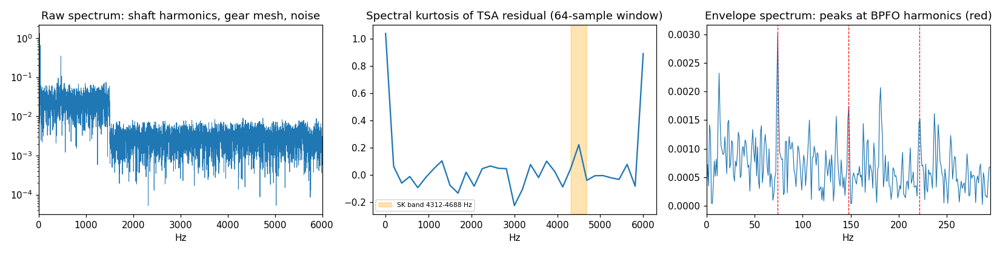

# Bearing fault diagnostics — envelope analysis, spectral kurtosis, TSA, and ML on unseen machines

Diagnose rolling-element bearing faults (outer race, inner race, ball) from
vibration the way a condition-monitoring engineer does — and measure what
each signal-processing step actually contributes, on **machines the models
never saw in training**. Everything is implemented from first principles in
NumPy (FFT-based Hilbert transform, STFT spectral kurtosis, angle-domain
time-synchronous averaging, multinomial logistic regression).



*Left: in the raw spectrum the fault is invisible under shaft harmonics, a
gear-mesh tone, and low-frequency noise. Middle: spectral kurtosis of the
TSA residual picks the band around the structural resonance the impacts
excite. Right: the envelope spectrum of that band shows peaks at BPFO and
its harmonics.*

## Physics

**Kinematics** (`src/bearing.py`) — defect frequencies per shaft revolution:
BPFO = n/2 (1 − d/D cos α), BPFI = n/2 (1 + d/D cos α), BSF = D/2d (1 − (d/D cos α)²),
FTF = ½ (1 − d/D cos α). Verified against the published SKF 6205 values
(BPFO 3.5848, BPFI 5.4152, 2·BSF 4.7135, FTF 0.3983).

**Simulator** — each machine has its own bearing geometry, structural
resonance (2.5–4.8 kHz) and damping, gear mesh, and noise. Defect impacts
excite the resonance; rolling elements slip (~1% jitter in impact spacing);
inner-race impacts are amplitude-modulated at shaft speed (load zone), ball
impacts at the cage frequency; shaft speed 15–40 Hz; fault severity spans
barely detectable to obvious.

## Signal processing (`src/dsp.py`, `src/diagnose.py`)

1. **Time-synchronous averaging** — resample to the shaft-angle domain, average revolutions, subtract → removes shaft harmonics and gear mesh.
2. **Spectral kurtosis** (Antoni, STFT-based) over several window lengths → the most impulsive band (kurtogram-style).
3. **Band-pass + Hilbert envelope** → squared-envelope spectrum.
4. **Fault evidence** — peak-to-floor ratio at each fault frequency and its 2nd/3rd harmonics.
5. **Modulation sidebands** — BPFI ± shaft speed (inner), 2·BSF ± FTF (ball); a fixed outer-race defect is unmodulated.

## Results (`python src/run_study.py`)

960 training records from 30 machines; **480 test records from 15 unseen
machines**. Thresholds and rule parameters tuned on training machines only.

### What each step contributes (physics rule)

| chain | accuracy | missed faults | false alarms | outer | inner | ball |
|---|---|---|---|---|---|---|
| raw spectrum at fault frequencies | 0.250 | 0.486 | 0.458 | 0.07 | 0.33 | 0.06 |
| envelope, full band | 0.260 | 0.819 | 0.175 | 0.03 | 0.10 | 0.08 |
| + spectral-kurtosis band | 0.823 | 0.164 | 0.083 | 0.69 | 0.92 | 0.77 |
| + TSA residual | 0.829 | 0.164 | 0.067 | 0.71 | 0.92 | 0.76 |
| + modulation sidebands | **0.854** | 0.164 | 0.067 | 0.75 | 0.92 | 0.82 |

Demodulation of the right band is the decisive step (0.26 → 0.82). TSA adds
little here because the kurtosis-selected band already avoids the gear mesh,
but it lowers false alarms.

### Classifiers on unseen machines

| features | accuracy | missed faults | false alarms |
|---|---|---|---|
| generic statistics (RMS, kurtosis, crest, band energies, …) | 0.431 | 0.369 | 0.033 |
| physics envelope + sideband features | **0.873** | 0.158 | 0.025 |
| both | 0.871 | 0.158 | 0.017 |

Generic features learn machine-specific spectra and do not transfer to new
machines; features tied to bearing kinematics do.

### Detectability vs severity

Fault recall is **96–100%** for moderate and severe faults (severity ≥ 0.4),
and 32% for the faintest third (0.15–0.4), whose impacts sit near the noise
floor — that is where nearly all remaining misses are.

## Three things the data taught (bugs found and fixed)

1. **A demodulation band narrower than the fault rate erases the fault.** At
   high shaft speed the most kurtotic STFT window was ~190 Hz wide while
   outer-race impacts repeated at 177 Hz; the envelope cannot show a rate
   wider than its band. Outer-race recall was 0.29. Requiring bands ≥ 3× the
   highest fault frequency raised accuracy from 0.65 to 0.83. (Outer-race
   faults were hit hardest because constant-amplitude impacts have lower
   spectral kurtosis than modulated ones.) A regression test now covers it.
2. **Fault frequencies coincide.** For about half of random bearing
   geometries, 2·BSF or a harmonic falls within 3% of BPFO/BPFI — frequency
   alone cannot separate them. Modulation sidebands can.
3. **"Max over a window ÷ median floor" is biased.** Pure noise scores ~2×,
   which pushed every tie toward the modulated fault types. Sideband evidence
   is now measured relative to the same statistic on surrounding noise, and a
   modulated fault must show real sideband evidence to win a tie.

## Run it

```bash
pip install -r requirements.txt
python -m pytest -v tests     # 18 tests, ~1 s
python src/run_study.py       # full study, ~1 min
```

## Limits

Simulated data with constant shaft speed and a known speed reference; real
machines add speed variation (needing order tracking), transmission paths,
multiple simultaneous faults, and sensor issues. The next step would be
validating on public run-to-failure datasets (e.g. CWRU, IMS, Paderborn) and
adding a CNN on order-normalised envelope spectra.
