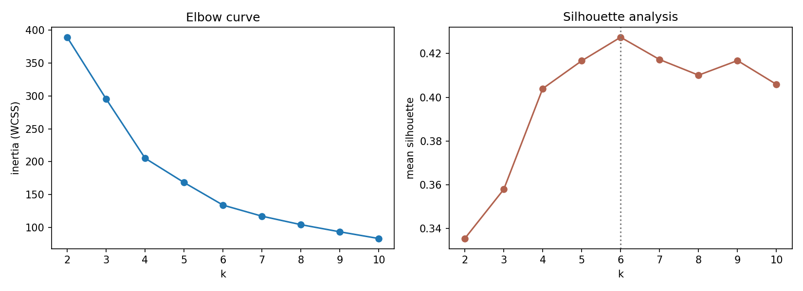
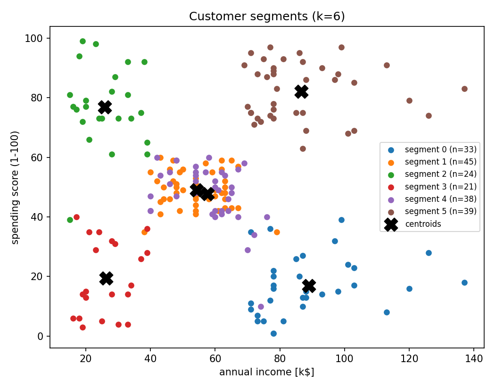
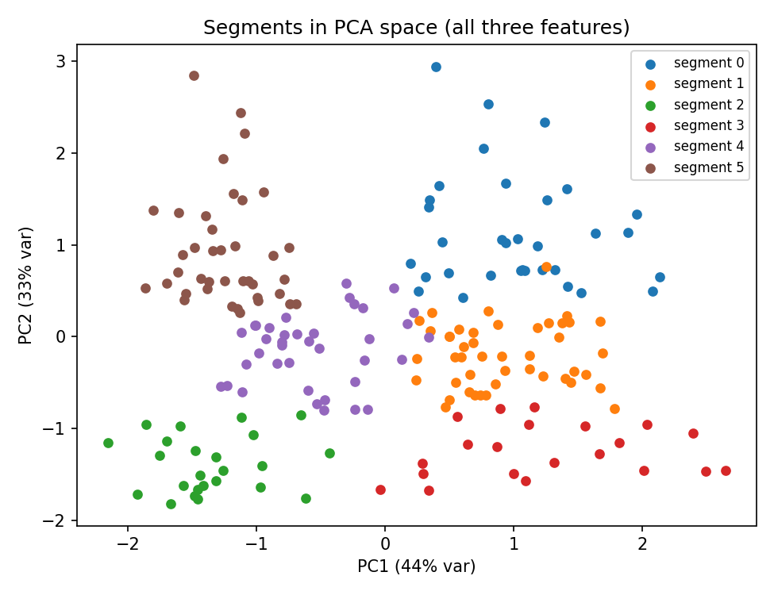

# Customer Segmentation

Unsupervised segmentation of mall customers with **k-means++
implemented from scratch**, model selection via elbow + silhouette
analysis (also from scratch), and business-ready segment profiles.

## Data

The Mall Customers dataset (200 customers): age, annual income,
spending score (1–100), gender. Clustering uses the three numeric
features, standardized so income (15–137 k$) doesn't dominate age.

## Approach

1. **k-means++ initialization** with 10–20 restarts, Lloyd iterations
   to convergence; best-of-restarts by inertia.
2. **Model selection:** sweep k = 2…10; the elbow curve flattens around
   5–6 and the mean silhouette peaks at **k = 6 (0.427)**.
3. **Profiling:** per-segment means in original units, sizes, and
   gender mix — the part a marketing team can actually use.

## Results — the six segments

| Segment | n | Age | Income (k$) | Spending | Reading |
|---|---|---|---|---|---|
| 5 | 39 | 33 | 87 | **82** | Affluent high-spenders — retain & reward |
| 2 | 24 | 25 | 26 | **77** | Young, low income, high spend — engage, credit risk aware |
| 4 | 38 | 27 | 58 | 48 | Young mainstream — growth potential |
| 1 | 45 | 56 | 54 | 49 | Older mainstream — steady value |
| 0 | 33 | 42 | **89** | 17 | High income, barely spending — biggest untapped opportunity |
| 3 | 21 | 46 | 26 | 19 | Low income, low spend — minimal targeting |





## Design decisions worth discussing

- **Standardization is not optional** for k-means: Euclidean distance
  on raw units would make income the only feature that matters.
- **Silhouette over elbow for the final call** — the elbow is ambiguous
  (as usual); silhouette gives a quantitative criterion. With age
  included, k=6 splits the classic 5-segment income/spending picture
  by life stage.
- **Restarts are required:** Lloyd's algorithm only finds local optima;
  single-init k-means gives visibly worse inertia on some seeds.
- **Clusters are a tool, not truth** — k-means partitions even
  structureless data, which is why validation indices and profile
  interpretability matter.

## Limitations / next steps

- Gaussian mixture models would give soft assignments (a customer can
  be 60/40 between segments); DBSCAN would test robustness to the
  spherical-cluster assumption.
- 200 customers is small; segment stability should be bootstrap-checked
  before acting on it.

## Run

```bash
python src/segment.py   # sweep, final model, profiles, figures (~3 s)
```
