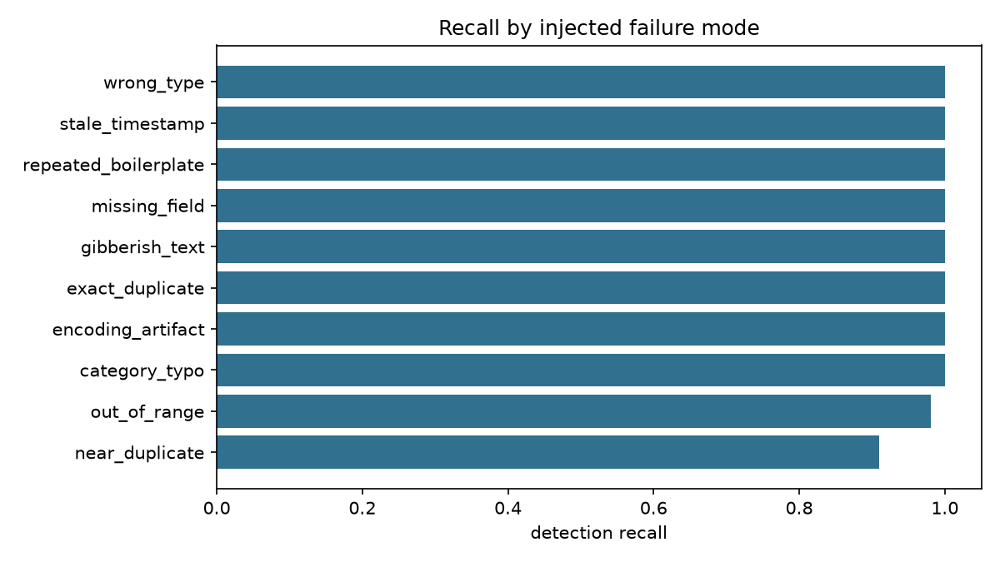
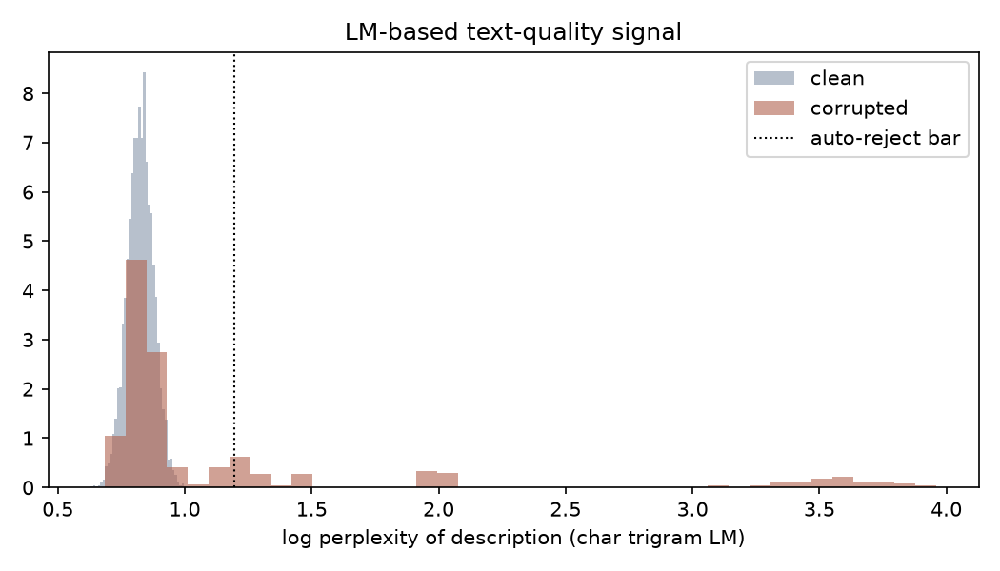

# Automated Data-Quality Verification

A layered system that verifies marketplace-style data at scale:
**deterministic rules → statistical checks → AI-driven fuzzy checks →
human-in-the-loop routing**, evaluated against injected ground-truth
defects. Built to mirror how real data-marketplace and LLM-pretraining
pipelines assure quality.

## The setup

`src/generate_dataset.py` creates 4,700 product-listing records and
corrupts 14.9% of them with ten realistic failure modes — exact and
near duplicates, missing fields, type errors, unit errors (price ×100),
mojibake encoding artifacts, gibberish text, boilerplate spam, category
typos, and out-of-window timestamps. Every record carries ground-truth
labels **used only for evaluation, never by the pipeline**.

## The pipeline (`src/checks.py`, `src/run_pipeline.py`)

| Layer | Technique | Catches |
|---|---|---|
| Rules | schema/type validation, canonical categories, timestamp window, mojibake regex | cheap, precise structural defects |
| Statistical | per-category price fences learned from reference data | unit errors, impossible values |
| Fuzzy / AI | **MinHash** near-duplicate detection (banded signatures over character shingles); **character-trigram LM perplexity** for gibberish; repetition ratio for boilerplate | what rules can't express |
| Routing | hard flag → auto-reject; soft flag → human review; else auto-accept | bounded review load |

The perplexity filter is the same idea used to clean LLM pretraining
corpora (e.g. KenLM-based filtering): text that a reference language
model finds surprising is usually junk.

## Results (4,700 records, 700 corrupted)

| Metric | Value |
|---|---|
| Defect recall (flagged = reject + review) | **99.3%** |
| Defect leakage into auto-accepted data | **0.13%** |
| Human review load | 8.5% of volume |
| Flagging precision | 71.4% (see below) |

Recall by failure mode: 100% on eight of ten modes; 98.1% on unit
errors; 94.0% on near-duplicates.




`results/review_queue_sample.md` shows what a human reviewer would
actually see: each record with its flags, reasons, and scores.

## Three lessons this system had to learn (the interesting part)

1. **Your reference statistics get poisoned by the defects you're
   hunting.** The first version fit price ranges and perplexity
   thresholds with percentiles over the "passes-rules" pool — but that
   pool contains the undetected defects, whose extreme values inflate
   the percentiles, which then fail to flag them. Recall on unit
   errors was 26% until the fences switched to quartile/MAD-based
   robust statistics (immune to few-percent contamination): 98%.
2. **Duplicate pairs are symmetric.** Without provenance metadata there
   is no way to know which member of a near-duplicate pair is the
   original; auto-rejecting the "later" one is a coin flip that
   discards good data half the time (measured: 46% recall). The fix is
   to quarantine *both* for review — recall rose to 94%, at the cost of
   flagging the innocent originals (which is exactly why measured
   precision is 71%: operationally correct quarantines that ground
   truth counts as false positives).
3. **Precision, recall, and review load are a three-way dial.** This
   configuration chooses near-zero leakage (0.13%) at 8.5% review
   load; a marketplace with cheaper reviewers or costlier escapes
   would tune it differently. The thresholds are explicit constants,
   not buried magic.

## Limitations / next steps

- An LLM-as-judge layer for semantic defects (description contradicts
  category, factual nonsense) — the natural modern extension of the
  fuzzy layer; the routing scaffolding here is where its verdicts
  would plug in.
- Drift monitoring: reference statistics should be refit on a rolling
  window with change-point alarms.
- Provenance (supplier ID, submission time) would resolve duplicate
  directionality and enable per-supplier trust scores.

## Run

```bash
python src/generate_dataset.py   # build corpus + ground truth
python src/run_pipeline.py       # verify, route, evaluate (~3 s)
```

## Operations: Docker, Airflow, MLflow

The pipeline is packaged for scheduled, tracked execution:

- **Docker** — `docker compose up --build` runs the full pipeline in a
  container, with `data/` and `results/` volume-mounted to the host.
- **Airflow** — [`airflow/dags/data_quality_dag.py`](airflow/dags/data_quality_dag.py)
  orchestrates it as a daily two-task DAG
  (`generate_dataset >> run_verification`); setup instructions for the
  official Airflow docker-compose quickstart are in the DAG docstring.
- **MLflow** — if `mlflow` is installed, every pipeline run logs its
  thresholds, headline metrics (precision/recall/leakage/review load),
  and all artifacts to the `data-quality-verification` experiment;
  compare runs with `mlflow ui`. Without mlflow installed the pipeline
  runs identically and simply skips tracking.

A Snowflake port of the companion SQL analysis lives in
[`student-outcomes-analysis/sql/snowflake_queries.sql`](../student-outcomes-analysis/sql/snowflake_queries.sql).
