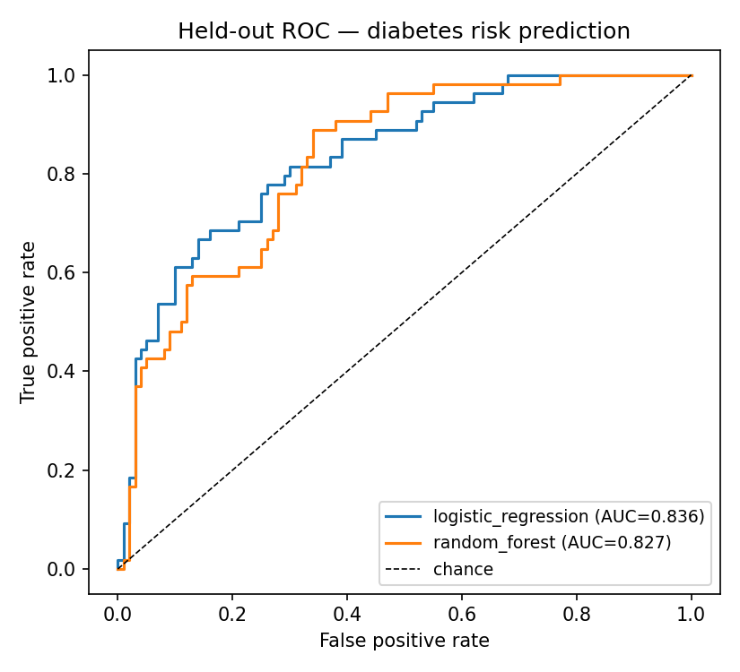
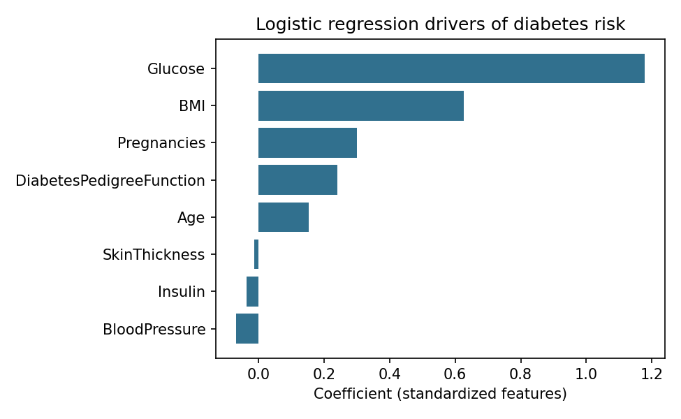
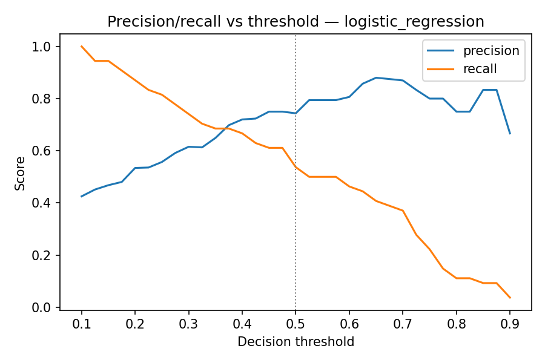

# Diabetes Risk Prediction

Binary classification of diabetes onset from routine clinical
measurements, with **logistic regression and a random forest implemented
from scratch** (no scikit-learn) and a leakage-safe evaluation pipeline.

## Data

[Pima Indians Diabetes dataset](https://www.kaggle.com/datasets/uciml/pima-indians-diabetes-database)
(originally from the National Institute of Diabetes and Digestive and
Kidney Diseases): 768 female patients, 8 features, 34.9% positive rate.

A key data-quality issue drives the pipeline design: several columns use
`0` to encode *missing*, which is biologically impossible:

| Column | Zeros treated as missing |
|---|---|
| Glucose | 5 (0.7%) |
| BloodPressure | 35 (4.6%) |
| SkinThickness | 227 (29.6%) |
| Insulin | 374 (48.7%) |
| BMI | 11 (1.4%) |

These are converted to NaN and median-imputed — with medians learned on
each training fold only, never on validation or test data.

## Approach

1. Stratified 80/20 train/test split (test set touched exactly once).
2. 5-fold stratified cross-validation on the training set comparing
   logistic regression (gradient descent, L2) and a random forest
   (bagged CART trees, vectorized Gini split search, √d feature
   subsampling).
3. Refit on the full training set; single held-out evaluation.

## Results

| Model | CV AUC (5-fold) | Holdout AUC | Accuracy | Precision | Recall | F1 |
|---|---|---|---|---|---|---|
| Logistic regression | 0.841 ± 0.035 | **0.836** | 0.773 | 0.744 | 0.537 | 0.624 |
| Random forest | 0.835 ± 0.029 | 0.827 | 0.747 | 0.692 | 0.500 | 0.581 |

These match published benchmarks for this dataset (~0.83 AUC), which is
a useful sanity check that the from-scratch implementations are correct.





## Design decisions worth discussing

- **AUC as the selection metric, not accuracy** — with 35% prevalence, a
  useless "always negative" model already gets 65% accuracy.
- **Imputation inside CV folds** — imputing before splitting leaks test
  statistics into training and inflates scores.
- **The linear model wins here.** With 768 samples and 8 features,
  the forest's extra capacity buys variance, not signal. Simpler is
  better at this data size.
- **Threshold is a product decision.** At the default 0.5 the model
  misses ~46% of true cases; the threshold sweep shows how recall can be
  bought with precision for a screening use-case.

## Limitations / next steps

- Recall at the default threshold is low; a deployed screening tool
  would use a lower threshold or cost-sensitive training.
- Missingness may be informative (e.g. insulin measured only for
  sicker patients); adding "was missing" indicator features is a
  natural extension.

## Run

```bash
python src/test_basics.py   # sanity tests for models + metrics
python src/train.py         # full pipeline (~8 s)
```
