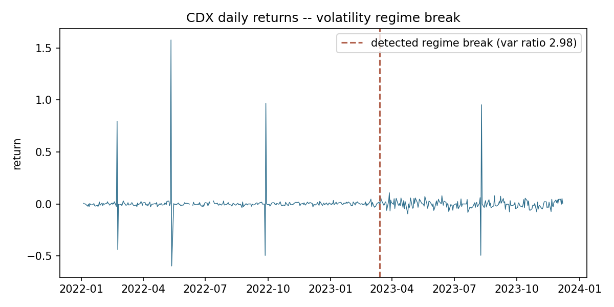

# Financial Data-Health Monitor

Automated **data-correctness and anomaly monitoring** for a market-data
feed: the kind of system that ensures data health in production data
stores and live feeds, flags abnormal behavior, and runs unattended for
ongoing monitoring. Built on a synthetic multi-ticker price panel with
**injected defects and known ground truth**, so every detector is scored
on whether it catches what it should.

## The problem it monitors

Production price feeds fail in characteristic ways. `src/generate_prices.py`
simulates a 6-ticker, 2-year daily panel and injects each one, with labels:

| Defect | What it simulates |
|---|---|
| Missing values | a feed drops a cell |
| Stale prices | a feed sticks, repeating the last value |
| Outlier bad ticks | a fat-finger / bad print that spikes and reverts |
| Missing dates | a whole trading day absent from the feed |
| Volatility regime break | a ticker whose behavior structurally changes |

## The monitor

Two layers, mirroring how you'd actually catch these:

- **Deterministic correctness checks** (`src/checks.py`) — missing cells,
  stale (exactly-repeated) prices, non-positive values, and missing
  business days. Cheap and precise.
- **Statistical anomaly detection** (`src/anomaly.py`) — a robust
  **MAD z-score** on returns for bad ticks (median/MAD so the outliers
  don't inflate their own threshold), and a **variance change-point scan**
  for volatility regime breaks. The change-point uses robust dispersion
  on purpose: a single bad tick would blow up ordinary variance and
  masquerade as a regime shift — MAD ignores it.

`src/monitor.py` runs everything, produces a per-defect health report,
and — because the defects are known — scores itself.

## Results (validated against ground truth)

```
missing     recall 100% (10/10)
stale       recall 100% (14/14)
date_gaps   recall 100% (4/4)
outlier     recall 100% (8/8)
regime      {CDX} | correct=True  no-false-alarms=True
```

Every injected defect is caught; the volatility regime break is isolated
to the right ticker (CDX) with no false alarms on the other five — the
detector that naively used variance instead flagged *all six*, which is
exactly why the robust version matters.



## The same check in R

`src/health_report.R` reproduces the per-ticker return summary and the
robust MAD outlier flags **in base R** (no packages needed) — the tabular
analysis stack here is SQL/Pandas/R, so the check is shown in R as well as
Python. Base R's `mad()` is already scaled by 1.4826, matching the Python
detector, and the two agree on the flagged outliers.

```bash
Rscript src/health_report.R      # run from the project root
```

## Run

```bash
pip install -r requirements.txt
python src/generate_prices.py    # build panel + inject defects
python src/monitor.py            # run checks, score, write report + figure
python -m pytest tests/ -v       # unit + integration tests
```

## Limitations / next steps

- One synthetic scenario; real feeds bring corporate actions, halts, and
  legitimately-equal prices that a production version must whitelist.
- Point checks are exact by construction here; on real data the
  thresholds (staleness runs, MAD k, regime ratio) need calibration
  against a labeled incident history.
- The monitor runs as a batch; scheduling it (Airflow, as in
  [`../data-quality-verification`](../data-quality-verification/)) turns
  it into the continuous feed-health watch the design targets.
