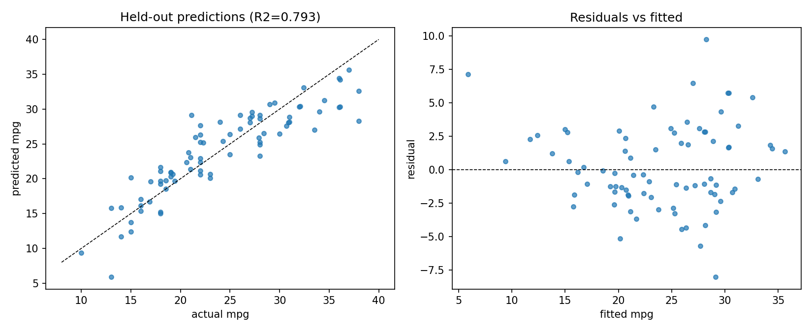
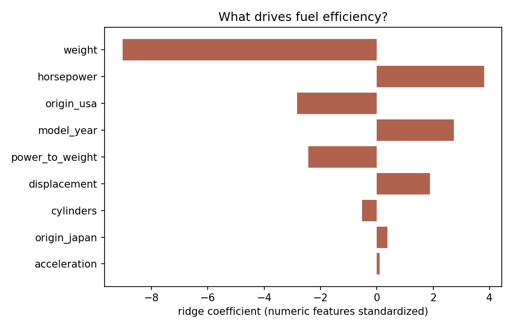
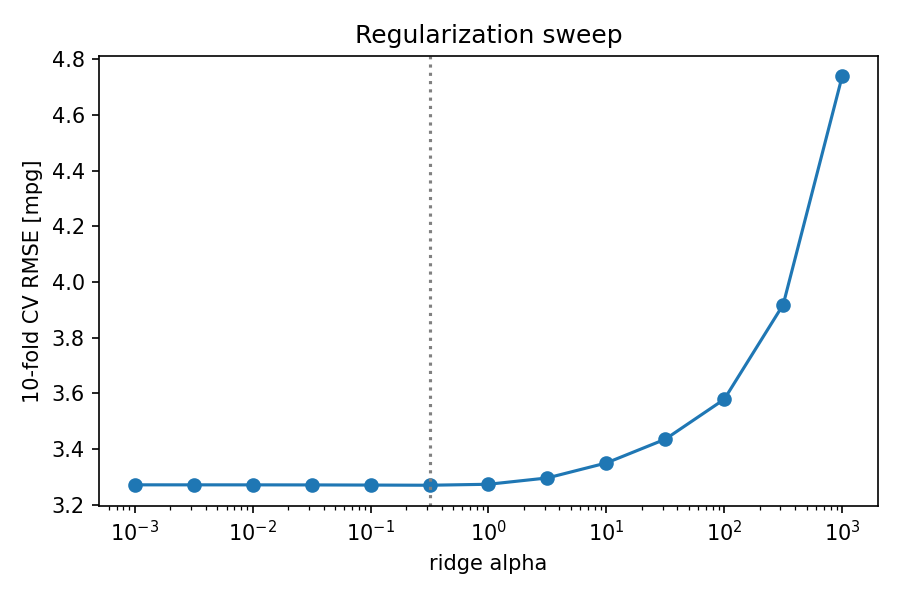

# Fuel Efficiency Regression

Predicting a car's fuel consumption (MPG) from its physical
characteristics, with **OLS and ridge regression implemented from
scratch** (normal equations / closed-form ridge) and full regression
diagnostics.

## Data

The classic [Auto MPG dataset](https://archive.ics.uci.edu/dataset/9/auto+mpg)
(UCI / seaborn mirror): 398 cars from 1970–1982. Real-world messiness
included: 6 cars have missing horsepower, imputed with the training-fold
median inside every CV fold.

## Approach

- Features: cylinders, displacement, horsepower, weight, acceleration,
  model year, one-hot origin, plus an engineered
  **power-to-weight ratio**.
- Numeric features standardized (scaler fit on training folds only).
- 10-fold cross-validation comparing a mean-prediction baseline, OLS,
  and ridge regression over a 13-point regularization sweep.
- Held-out 80/20 split for residual diagnostics.

## Results

| Model | CV RMSE (mpg) | CV R² |
|---|---|---|
| Mean baseline | 7.79 | ~0 |
| OLS | 3.27 | 0.816 |
| Ridge (α = 0.32) | **3.27** | **0.817** |

Held-out: RMSE 3.13, MAE 2.52, R² 0.793.





## Design decisions worth discussing

- **Ridge ≈ OLS here — and that's the finding.** With 398 samples and
  ~10 well-conditioned features, regularization has little to add; the
  sweep demonstrates that instead of assuming it.
- **The intercept is not penalized** in the ridge solution — a detail
  that's easy to get wrong and biases predictions if missed.
- **Residuals-vs-fitted shows mild curvature** at the high-MPG end:
  the linear model under-predicts very efficient cars. A log(mpg)
  target or interaction terms would be the next step — kept out of
  scope to keep the model interpretable.
- **Model year matters** (~+2.8 mpg per standardized unit): efficiency
  improved steadily through the late 1970s, independent of car size.

## Limitations / next steps

- Gradient-boosted trees typically reach ~2.6 RMSE on this dataset;
  the gap quantifies what nonlinearity is worth here.
- Log-target variant and prediction intervals (via residual bootstrap)
  are natural extensions.

## Run

```bash
python src/analyze.py   # full pipeline (~3 s)
```
