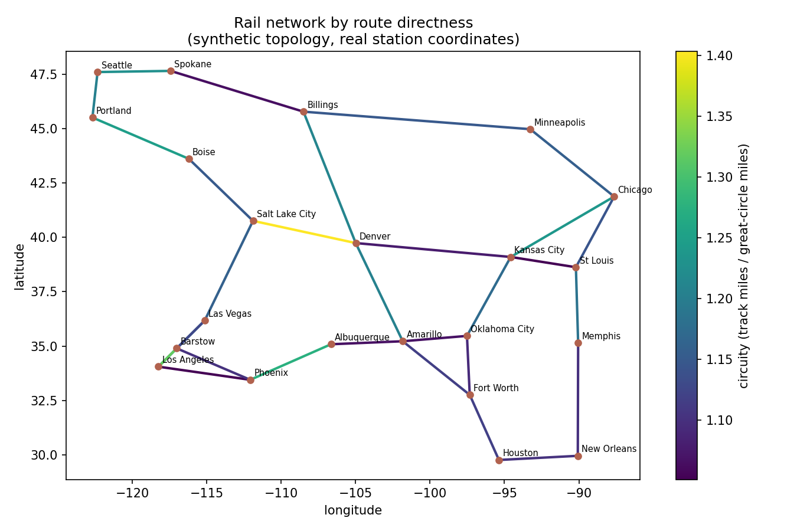

# Geospatial Rail Network Analysis

Geospatial analysis of a rail network using **real station coordinates**:
great-circle geodesy implemented from scratch, a **GeoPandas/Shapely**
layer for real geometry work, and a data-quality check that validates
tabulated mileages against geography.

Companion to [`../rail-network-optimizer`](../rail-network-optimizer/)
(Java routing over the same network) — this project asks the questions
that need actual coordinates rather than graph topology.

## The check that found a real bug

Track distance can never be shorter than the great-circle distance between
its endpoints — rails curve around terrain, they don't tunnel through the
earth. So **circuity** (track miles ÷ great-circle miles) must be ≥ 1, and
sits around 1.1–1.4 for real corridors.

Running this against the network's own mileage table caught an error:

```
Billings -> Minneapolis: 700 mi track vs 740 mi great-circle (circuity 0.95)
```

Physically impossible — the tabulated mileage was wrong. It's now corrected
to 850 mi (circuity 1.15), and the optimizer's routes changed accordingly.
That's the point of the check: geography is an independent source of truth
you can validate operational data against.

Current state of the network:

```
$ python src/validate_distances.py
Validated 30 segments against great-circle distance
  median circuity factor: 1.15
  physically impossible (< 1.0): 0
  implausibly winding (> 2.0): 0
  most indirect segment: Salt Lake City -> Denver (circuity 1.40)
```

Salt Lake City → Denver being the least direct segment is a sanity check in
itself — that's the route through the Rockies.



## Two layers, on purpose

**`src/geo_core.py` — geodesy from first principles (NumPy only).**
Haversine great-circle distance, initial bearing, bounding boxes, and
nearest-neighbour search over points on a sphere. Validated against
published distances (LAX→JFK computes to 2,469 mi vs ~2,475 published —
the expected spherical-vs-ellipsoidal difference). Runs with no geospatial
dependencies.

**`src/geo_analysis.py` — the standard stack (GeoPandas + Shapely).**
Builds a GeoDataFrame of stations (Points) and segments (LineStrings), and
does the geometry work properly:

- **Reprojection before measurement.** Lengths and buffers computed in
  degrees are meaningless, so anything metric happens in an equal-area
  projection (EPSG:2163) and converts to miles. A test explicitly guards
  against the classic bug of measuring length in degrees.
- **Corridor buffers + spatial join** — which stations fall within *n*
  miles of a given corridor.
- **Nearest terminal to an incident**: given arbitrary coordinates (a
  derailment, a washout), which terminal is closest and how far.
- Network extent, total length, and a plotted map.

## Run

```bash
pip install -r requirements.txt

python src/validate_distances.py   # geodesy + data validation (no geo deps needed)
python src/geo_analysis.py         # GeoPandas: projection, buffers, nearest, map
python -m pytest tests/ -v
```

`tests/test_geo_core.py` runs anywhere; `tests/test_geo_analysis.py` skips
when GeoPandas isn't installed and runs for real in this project's CI job.

## Data

`data/stations.csv` holds **real coordinates** for 22 western U.S. cities.
`data/segments.csv` mirrors the synthetic network topology from the
optimizer project — representative corridors and plausible mileages, not
any carrier's actual or proprietary network.

## Limitations / next steps

- Segments are modeled as straight lines between endpoints; real track
  geometry would come from a shapefile/GeoJSON of the actual alignment,
  which would make circuity exact rather than an estimate.
- Spherical earth model (haversine); a geodesic on the WGS84 ellipsoid
  (`pyproj.Geod`) is more accurate over long distances.
- No terrain, grade, or elevation data — the natural next input for
  explaining *why* a corridor is indirect.
