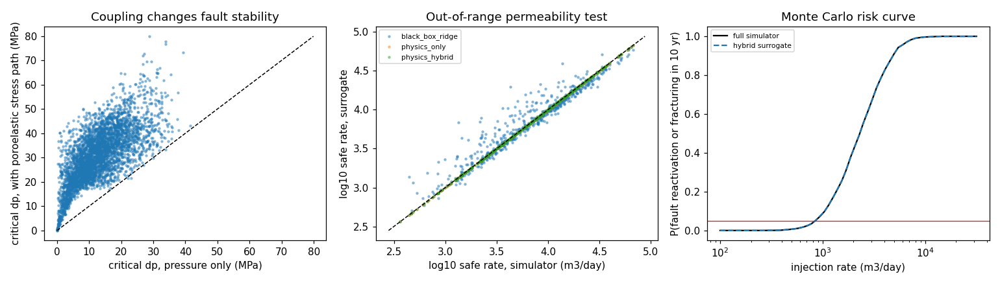

# Injection-induced fault reactivation — coupled flow + geomechanics, ROM, and ML surrogates

How much fluid (CO₂, wastewater, geothermal brine) can be injected into a
reservoir for 10 years before a nearby fault slips or the rock fractures?
This project answers that with a verified numerical model, quantifies how
much the **poroelastic coupling** matters, and builds a **reduced-order
model** and **surrogates** fast enough for Monte Carlo risk assessment.
Everything is written from first principles in NumPy (no SciPy), and every
solver is verified against an analytical benchmark.



## Model

| piece | file | what it does |
|---|---|---|
| Consolidation benchmark | `src/consolidation.py` | Terzaghi 1D consolidation (coupled flow–deformation), Crank–Nicolson FD with Rannacher start-up, vs. the Fourier-series solution |
| Injection pressure | `src/radial_flow.py` | Radial single-phase diffusion; batched finite-volume solver (log-spaced grid, Crank–Nicolson, Thomas algorithm vectorised over thousands of reservoirs); two-zone permeability (near-well damage/stimulation) and closed outer boundary (compartmentalised reservoir); Theis solution for verification |
| Well function | `src/expint.py` | Exponential integral E1 (series + continued fraction), accurate to ~1e-15 |
| Geomechanics | `src/fault_stability.py` | In-situ stresses with depth (normal-faulting regime), fault-plane traction, Mohr–Coulomb slip criterion, **poroelastic stress path** Δσₕ = α(1−2ν)/(1−ν)·Δp, and the hydraulic-fracturing limit |
| Reduced-order model | `src/rom.py` | POD (SVD) of pressure profiles + Gaussian RBF interpolation of the POD coefficients over dimensionless parameters |
| Surrogates | `src/surrogate.py` | Closed-form physics estimate (Theis → pseudo-steady state + Hawkins skin), a learned correction (hybrid), and a black-box ridge baseline |

The safe rate is the smaller of two limits: the pressure at the fault must
stay below its reactivation threshold, and the pressure at the well must
stay below 90% of the fracturing limit.

## Results

From `python src/run_study.py` (fixed seeds; full tables in
`results/results.md`, raw numbers in `results/metrics.json`).

### Verification

- **Terzaghi consolidation:** max error 1.7×10⁻⁵ of the initial pressure; observed convergence order **2.00**.
- **Injection solver vs. Theis** (3 reservoirs × 3 radii, 10 years):

| cells | time steps | max relative error |
|---|---|---|
| 60 | 75 | 0.81% |
| 120 | 150 | 0.50% |
| 240 | 300 | 0.10% |
| 480 | 600 | 0.017% |

- **Mass balance** in a closed reservoir: injected volume equals stored volume to 10⁻⁶ (tested).
- **Fault stability** matches the analytical Mohr-circle result for an optimally oriented fault, and the coupled Coulomb function matches an independent hand calculation (tested).

### Coupling matters

Over 4,000 random faults (normal-faulting stress regime, fault inside the
reservoir), the median pressure increase needed to reactivate a fault is
**11.9 MPa** if only pore pressure is considered, but **30.7 MPa** once the
poroelastic stress path is included (median ratio **2.6×**). 4.4% of faults
are already critically stressed, and fault slip — rather than hydraulic
fracturing — is the binding limit for 38% of cases.

A finding the code had to handle: with a strong stress path the horizontal
stress can overtake the vertical stress during injection, so the resolved
shear stress passes through zero and the Coulomb function is **not
monotonic**. The solver therefore scans for the *first* crossing before
bisecting, and the fracture limit tracks whichever principal stress becomes
the minimum.

### Surrogates for the safe injection rate

2,000 simulated reservoirs for training; tested in range and on a
**higher-permeability range never seen in training**. Error in log10 of the
safe rate (m³/day); "unsafe" = surrogate over-predicts the safe rate by >10%.

| model | in range: median error | in range: unsafe | out of range: median error | out of range: unsafe |
|---|---|---|---|---|
| black-box ridge (given the same geomechanics inputs) | 5.3% | 9.1% | 8.8% | 25.7% |
| closed-form physics | 0.2% | 0.0% | 0.1% | 0.0% |
| physics + learned correction | 0.1% | 0.0% | 0.1% | 0.0% |

The physics estimate only became this accurate after the simulator showed
where it failed: plain Theis ignores the closed reservoir boundary (90%+
errors at the 95th percentile), so the estimate switches to the
pseudo-steady-state solution once D·t/Rₑ² > 0.2 (threshold calibrated on a
separate calibration set). The learned correction then adds little —
the honest lesson is that verified physics beats a black box, especially
outside the training range, where the black box over-predicts the safe
rate for a quarter of reservoirs.

### Reduced-order model

8 POD modes capture 99.99% of the pressure-profile variance; the POD + RBF
model predicts full profiles with **0.20% median / 1.15% p95** error in
~0.1 ms each. Interpolating in dimensionless groups (D·t/Rₑ², Rₑ, k ratio,
near-well radius) instead of raw parameters cut the p95 error from ~5% to
~1% (hyperparameters chosen on a separate validation set).

### Monte Carlo risk assessment

A site with uncertain permeability (log-normal), fault friction, and
minimum horizontal stress, 2,000 realisations: the rate with a 5% chance of
fault reactivation or fracturing within 10 years is **844 m³/day** from the
full simulator and **842 m³/day** from the hybrid surrogate, which runs
**~4,600× faster** (11 s → 2.5 ms).

## Run it

```bash
pip install -r requirements.txt
python -m pytest -v tests          # 22 tests, ~3 s
python src/run_study.py            # full study, ~30 s
python src/run_study.py --quick    # smoke run
```

## Limits

Single-phase, isothermal, radial flow in a homogeneous layer (apart from the
near-well zone and a closed boundary); a uniaxial-strain stress path; one
fault inside the reservoir; cohesionless Mohr–Coulomb friction. A
production study would use multiphase CO₂–brine flow, 3D geology and fault
geometry, full coupled poroelastic FEM (e.g. Abaqus, FLAC3D), and
rate-and-state friction for seismicity. The coupling result is specific to
the normal-faulting regime and the in-reservoir fault assumed here.
