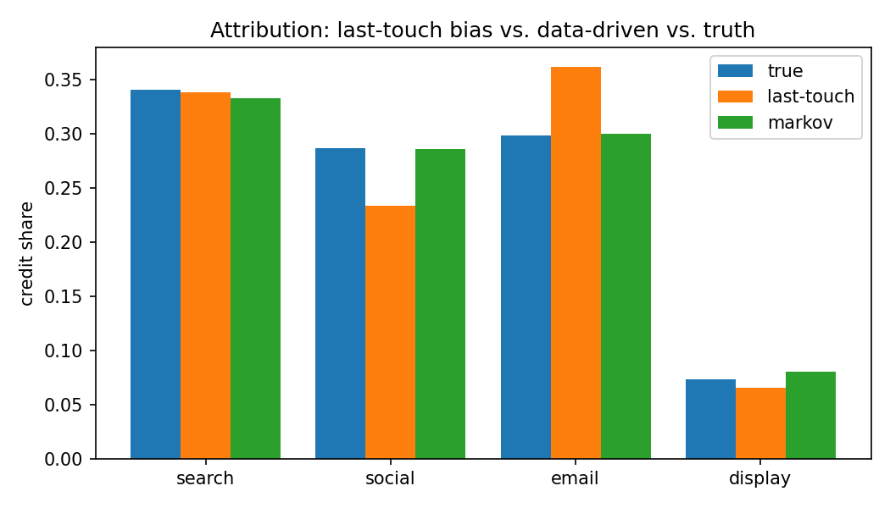
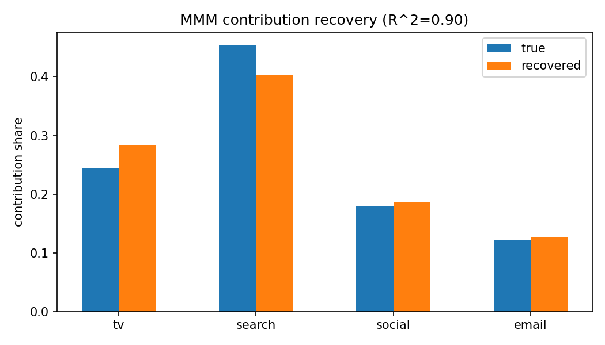

# Marketing Attribution & Media Mix Modeling

Three questions every marketing team asks — *which touchpoints earn
credit, how much did each channel's spend actually drive, and did a
campaign truly cause a lift?* — answered with the standard toolkit:
**multi-touch attribution, media mix modeling (MMM), and a causal geo
holdout.** Every method is validated by recovering effects it was never
told, against data with known ground truth.

## Why synthetic data is the right call here

Real marketing data has no answer key: the true contribution of each
channel is unobservable, so you can never *prove* an attribution or mix
model is correct on it. This project generates data with **set** effects,
then checks whether each method recovers them — the only way to
demonstrate the methods actually work, not just that they run. (Numbers
below are the actual validated output; reproduce with the commands at the
bottom.)

## 1. Multi-touch attribution (`src/attribution.py`)

Rule-based models (first-/last-touch, linear, time-decay, position-based)
assign conversion credit by position — and they're biased. The
data-driven alternative is a **Markov removal-effect** model: journeys are
a Markov chain over channel states, and each channel's credit is its
*removal effect* — how much total conversion probability drops when that
channel is taken out of the graph.

| channel | true credit | last-touch | Markov |
|---|---:|---:|---:|
| search | 0.341 | 0.339 | 0.333 |
| social | 0.287 | 0.234 | 0.287 |
| email | 0.298 | **0.362** | 0.300 |
| display | 0.074 | 0.065 | 0.080 |

The Markov model recovers true credit almost exactly (**mean abs error
0.004**); last-touch is 8× worse (0.032) and visibly **over-credits
email** — the channel that happens to close paths — while under-crediting
social, which opens them. That's the classic attribution mistake,
quantified.



## 2. Media mix model (`src/mmm.py`)

MMM regresses weekly sales on channel spend transformed by **adstock**
(geometric carryover) and **saturation** (diminishing returns, a
self-calibrating Hill curve), fit with **ridge regression solved from
scratch** (no scikit-learn). Adstock rate is chosen per channel by grid
search.

Recovered vs. true, on 250 weeks:

| metric | result |
|---|---|
| Model fit (R²) | **0.90** |
| Contribution-share error (MAE) | **0.025** |
| ROAS rank correlation (Spearman) | **1.00** |

It recovers each channel's contribution share within ~2 points and gets
the efficiency ranking exactly right — search most efficient (ROAS ~14),
TV least (~3) — which is the actionable output: where the next marketing
dollar should go.



## 3. Causal campaign lift (`src/lift.py`)

A geo holdout with **difference-in-differences**: compare the treated
markets' pre→post change against the control markets', so any trend or
seasonality that would have happened anyway cancels out. Significance from
a **permutation test**, uncertainty from a **bootstrap CI** — the same
causal toolkit as [`../student-outcomes-analysis`](../student-outcomes-analysis/),
applied to marketing.

Injected lift **120** → DiD estimate **123.6**, 95% CI **[101, 146]**
(covers the truth), permutation **p = 0.0002**.

## What this demonstrates

Attribution modeling, media mix modeling (adstock/saturation/ROAS), and
causal campaign measurement — the core of marketing analytics — plus
from-scratch ridge, pandas/NumPy, and a validation-against-ground-truth
discipline. The honest caveat: it targets the *modeling* techniques, not
vendor tools (Adobe/Google Analytics, Alteryx), which need live accounts.

## Run

```bash
pip install -r requirements.txt
python src/generate_data.py     # build data + ground truth
python src/run_analysis.py      # run all three, validate, write figures
python -m pytest tests/ -v      # unit tests for each method
```

## Limitations / next steps

- One synthetic scenario; real MMM contends with more collinearity and
  needs Bayesian priors (e.g. PyMC-Marketing) for stable coefficients and
  credible intervals.
- Attribution assumes observed paths; unobserved touchpoints and
  view-through conversions would bias any model.
- DiD assumes parallel trends; a real rollout would test that assumption
  on pre-period data and consider a synthetic-control design.
