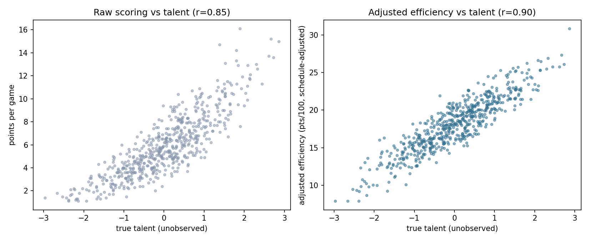
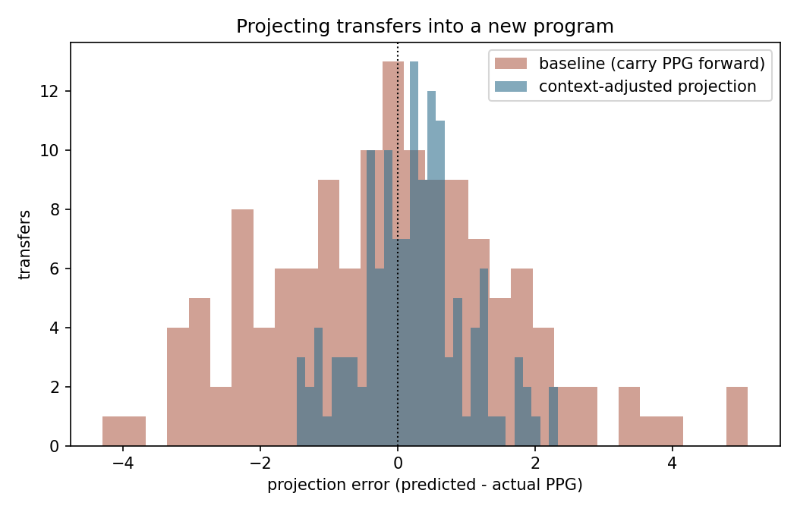

# NCAA Transfer Portal Analytics

Evaluating college basketball transfers: **does a player's production travel
when he changes programs?** Raw scoring averages say one thing, context-
adjusted rates say another — and the difference is exactly the question a
staff faces when recruiting out of the portal.

## The problem with points per game

Points per game is the number everyone quotes, and it bundles together
three things that have nothing to do with how good a player is:

```
points per game = points per 100 possessions × possessions played / 100
possessions played = team pace × (minutes played / 40)
```

A team playing 76 possessions per 40 minutes hands its players ~20% more
scoring chances than one playing 63. A starter's raw total dwarfs a bench
player's at equal skill. And efficiency drops against better opponents.
Strip those out and you get a rate that reflects the player:

```
points_per_100 = points_per_game / (pace × minutes / 40) × 100
adjusted       = points_per_100 + SOS_COEF × strength_of_schedule
```

## Does the adjustment actually help?

The data is simulated with a latent `true_talent` per player that is never
observed, so the measures can be scored against the truth:

| Season-1 measure | correlation with true talent |
|---|---:|
| Points per game | 0.854 |
| **Schedule-adjusted efficiency** | **0.900** |



A real but modest gain — raw scoring is a decent proxy because better
players do earn more minutes. The adjustment earns its keep somewhere else.

## Projecting a transfer into a new program

Projecting season-2 scoring from season-1 (RMSE, points per game):

| Group | n | Baseline (carry PPG) | Pace + SOS adjusted | Better by |
|---|---:|---:|---:|---:|
| All players | 584 | 1.69 | 1.63 | 3.5% |
| **Transfers only** | 135 | 1.77 | **1.51** | **14.6%** |
| Stayers only | 449 | 1.67 | 1.67 | 0.0% |

**That split is the whole result.** The adjustment improves projections by
14.6% for players who changed programs and by *nothing at all* for players
who stayed — which is exactly the signature it should have, because stayers
don't experience a context change. A method that "improved" both groups
would be fitting noise.



If the staff also specifies the intended role (minutes) at the new program,
RMSE drops much further (0.81 for transfers, ~54% better than baseline) —
but that uses information about the future, so it's reported separately as
an upper bound rather than as the headline.

## Finding undervalued transfers

Ranking each player on raw scoring and on adjusted efficiency, the biggest
gaps are players the box score sells short — limited minutes, slow pace, or
a punishing schedule:

| Player | PPG | Min | Pace | SOS | Adj. eff | Rank gap |
|---|---:|---:|---:|---:|---:|---:|
| P0437 | 4.3 | 13.6 | 65.2 | +0.67 | 20.5 | +56 |
| P0201 | 5.4 | 14.9 | 69.5 | +1.08 | 22.6 | +55 |
| P0168 | 4.8 | 15.3 | 68.7 | +1.23 | 20.2 | +46 |

A 4.3-points-per-game bench player on a slow team playing a hard schedule
grades out as a top-tier efficiency producer per possession.

## Data integrity first

Scouting feeds come from multiple sources and disagree. Before any modeling,
`src/data_checks.py` catches duplicate player-seasons, minutes exceeding the
length of a game, negative and missing box-score values — 22 bad rows
quarantined out of 1,206 here. Every one of those silently corrupts a player
valuation.

## Pipeline

| File | Role |
|---|---|
| `src/generate_data.py` | Simulates two seasons with latent talent, team pace/schedule, transfers, and injected data defects. |
| `src/data_checks.py` | Integrity checks and cleaning across the feed. |
| `src/adjust.py` | Pace/role/schedule adjustment and its inverse (projecting into a new context). |
| `src/model.py` | Baseline vs context projections, error metrics, undervalued-player board. |
| `src/run_analysis.py` | Runs everything, writes metrics and figures. |
| `src/polars_pipeline.py` | The same clean-join-adjust pipeline in **polars** (lazy query plan). |

## Run

```bash
pip install -r requirements.txt
python src/generate_data.py
python src/run_analysis.py
python src/polars_pipeline.py
python -m pytest tests/ -v
```

## Limitations

- **Simulated data.** Real box scores bring injuries, role changes, coaching
  systems, and development curves that this model doesn't have. The point
  here is the method and its validation, not the specific players.
- Scoring only — a real valuation needs rebounding, defense, playmaking,
  shooting splits, and lineup-level plus/minus.
- Linear schedule adjustment; real strength-of-schedule work uses
  opponent-adjusted efficiency ratings computed iteratively.
- Role projection is the weak link: a transfer's minutes at the new program
  are genuinely uncertain, and that uncertainty dominates the forecast.
