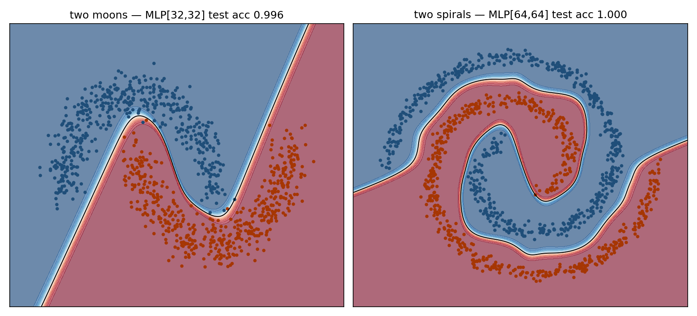
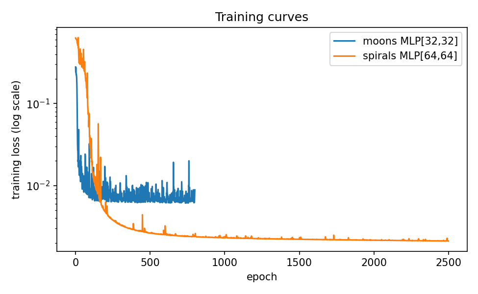

# Neural Network from Scratch

A multilayer perceptron — forward pass, backpropagation, mini-batch SGD
with momentum, L2 weight decay — implemented entirely in NumPy, with
**numerical gradient checking proving the backprop derivation correct
to ~1e-8 relative error**.

## Why this project

Frameworks make it easy to use networks without understanding them.
Writing the chain rule out by hand (and verifying it against central
finite differences) is the single best exercise for actually
understanding what `loss.backward()` does.

## Benchmarks

Two synthetic 2-D datasets where the decision boundary is visibly
nonlinear, with a from-scratch logistic regression as the linear
baseline (75/25 train/test split):

| Dataset | Linear baseline | MLP architecture | MLP test accuracy | Gradient check |
|---|---|---|---|---|
| Two moons | 0.872 | [2, 32, 32, 1] | **0.996** | 3.4e-08 |
| Two spirals | 0.620 | [2, 64, 64, 1] | **1.000** | 6.1e-08 |

The spirals result is the point of the exercise: a linear model is
barely better than chance (0.62), while two hidden layers untangle the
arms completely.




## Implementation notes

- **tanh hidden units + Xavier initialization** — smooth activations
  make gradient checking clean and keep pre-activations in range early
  in training.
- **Sigmoid + binary cross-entropy** collapse to the elegant gradient
  `(p - y)/n` at the output layer — derived in `nn.py`.
- **Gradient checking done right:** central differences, relative (not
  absolute) error, performed *before* training while weights are at
  their random initialization. Checking after training is misleading
  because gradients are near zero.
- **Momentum matters on the spirals:** plain SGD crawls through the
  loss plateau; momentum cuts training time several-fold.

## Limitations / next steps

- ReLU + He initialization, Adam, and softmax multi-class output are
  straightforward extensions of the same code structure.
- No early stopping — training length was chosen by watching the loss
  curve; a validation-based stopper is the obvious next step.

## Run

```bash
python src/train.py   # trains both benchmarks (~10 s)
```
