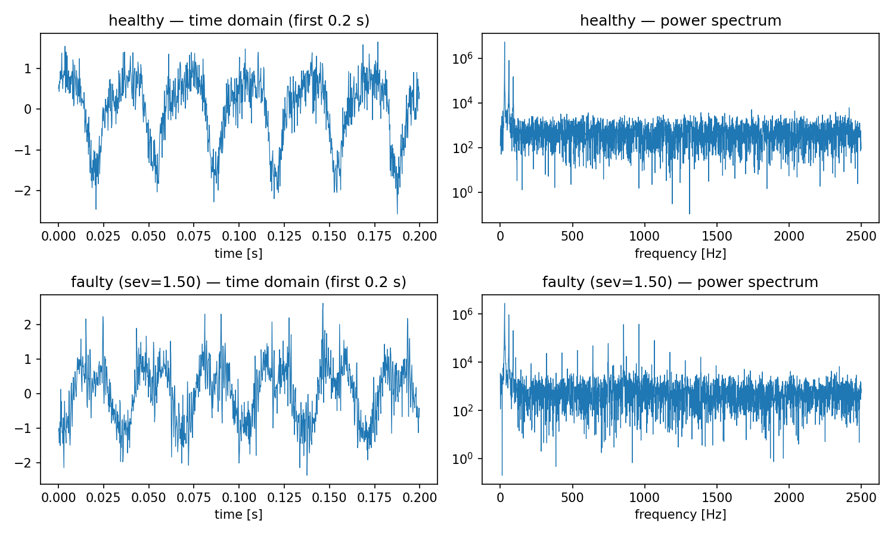
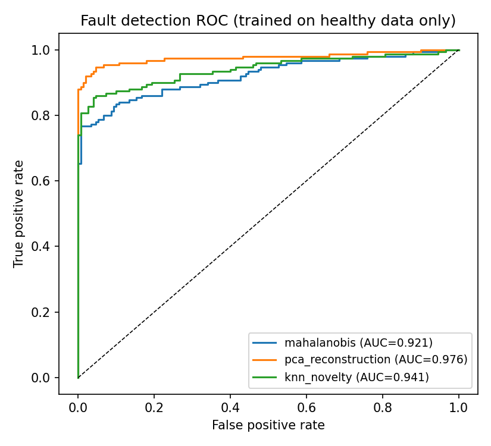
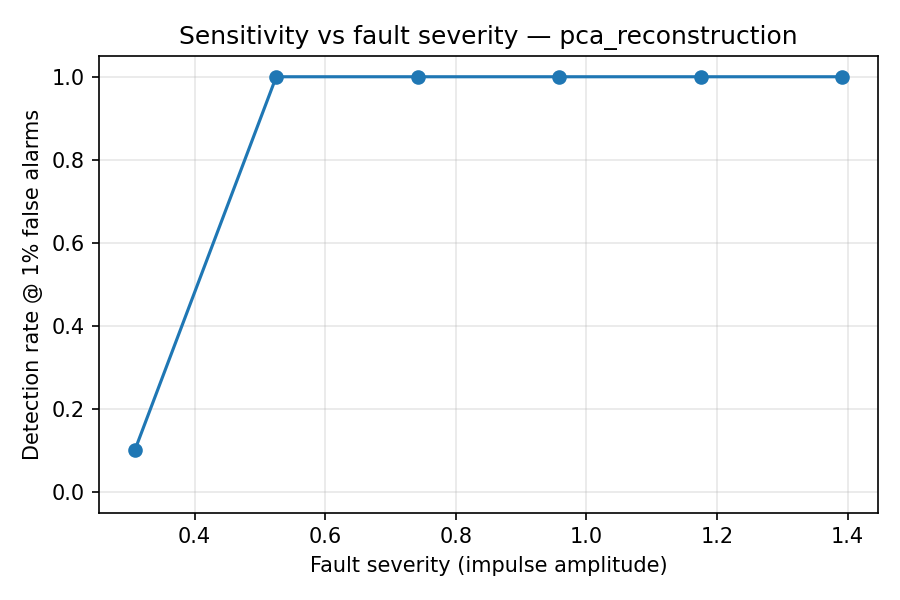

# Sensor Anomaly Detection — Bearing Fault Signatures

Unsupervised detection of bearing faults in vibration signals, trained
on **healthy data only** — the realistic industrial setting, where
failures are rare and labels don't exist.

## Data

A physics-motivated simulator (`src/generate_data.py`) generates 1-second
accelerometer windows at 5 kHz:

- **Healthy**: shaft fundamental (~29.7 Hz) + decaying harmonics,
  broadband noise, ±1% speed jitter and amplitude scatter run-to-run.
- **Faulty**: healthy signal + periodic impulse train at the
  bearing-pass frequency (3.585× shaft speed, an outer-race-style
  ratio). Each impact excites a decaying ~900 Hz structural resonance.
  Impulse amplitude scales with a continuous severity in [0.2, 1.5].

Simulation is a deliberate choice: it provides exact ground truth for
fault presence *and severity*, so detector sensitivity can be
characterized systematically — the same reason surrogate data is used
in industrial R&D when run-to-failure data is scarce.

Split: 300 healthy windows for training; 150 healthy + 150 faulty for
testing.

## Approach

Each window is reduced to 14 features: RMS, peak, crest factor, excess
kurtosis, skewness, spectral centroid, and 8 log-spaced FFT band-energy
fractions. Impact trains raise kurtosis and high-frequency band energy
long before overall RMS moves — which is why these features work.

Three detectors, all fit on healthy data only:

1. **Mahalanobis distance** (regularized covariance)
2. **PCA reconstruction error** (95%-variance subspace of healthy behavior)
3. **kNN novelty** (mean distance to 5 nearest healthy windows)

Alarm threshold = 99th percentile of healthy-training scores (a ~1%
false-alarm budget).

## Results

| Detector | AUC | Detection rate | False alarms |
|---|---|---|---|
| PCA reconstruction | **0.976** | **88.0%** | 0.7% |
| kNN novelty | 0.941 | 86.7% | 10.0% |
| Mahalanobis | 0.921 | 77.3% | 4.7% |





The severity curve shows the honest story: severe faults are caught
essentially always, while the mildest faults (amplitude ≈ noise floor)
are missed at a fixed 1% false-alarm budget. That detectability
threshold is exactly what a maintenance team needs to know.

## Design decisions worth discussing

- **Why unsupervised?** Labeled failures are rare in practice; training
  on healthy data only matches deployment reality.
- **Why does PCA reconstruction win?** Healthy variation (speed/amplitude
  jitter) lives in a low-dimensional subspace; faults add energy
  orthogonal to it. Mahalanobis assumes a single Gaussian cloud and is
  less robust to the heavy-tailed kurtosis feature.
- **Threshold from healthy quantiles** ties the alarm rate directly to
  an operational false-alarm budget instead of an arbitrary cutoff.

## Limitations / next steps

- Single fault mode and constant-speed operation; real machines have
  varying loads/speeds (order tracking would be the next step).
- An autoencoder detector and comparison on a public run-to-failure
  dataset (e.g. NASA IMS bearings) are natural extensions.

## Run

```bash
python src/generate_data.py   # writes data/vibration_windows.npz
python src/detect.py          # features, detectors, figures (~3 s)
```
