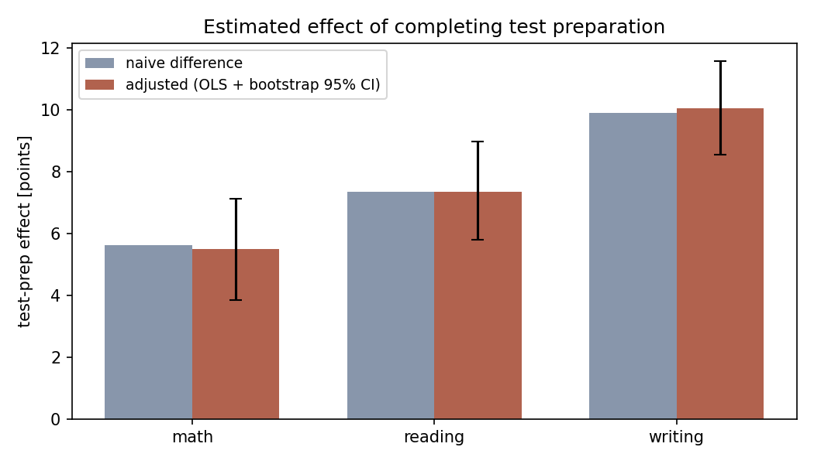
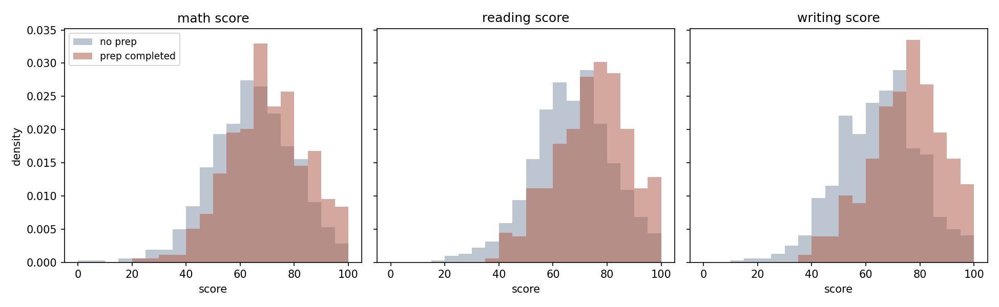
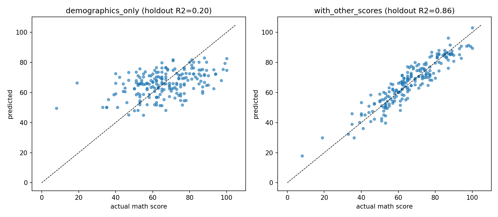
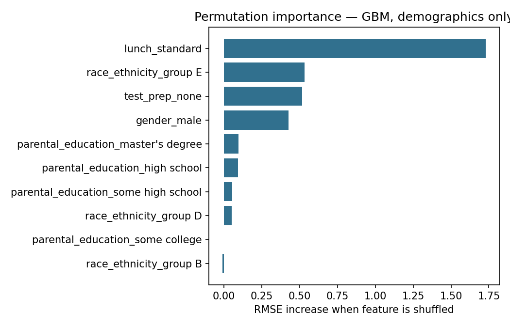

# Student Outcomes Analysis — Does Test Prep Work?

An end-to-end product-efficacy analysis on educational data: **SQL
pipeline → hypothesis testing → regression adjustment → predictive
modeling**, with gradient-boosted trees implemented from scratch. The
question is the one every EdTech product team asks: *did the
intervention (a test-preparation course) actually move outcomes?*

## Data

The widely used Students Performance in Exams dataset (1,000 students):
demographics, socioeconomic proxies (lunch status, parental education),
whether the student completed a test-prep course, and math/reading/
writing scores. It is a teaching dataset — the methods, not the
specific students, are the point here.

## 1. SQL layer

`src/build_database.py` loads the data into SQLite;
[`sql/queries.sql`](sql/queries.sql) answers first-pass product
questions (aggregates, cross-tabs, completion-rate selection checks,
and a window-function query); `src/run_sql_analysis.py` renders all
results to [`results/sql_results.md`](results/sql_results.md).

Headline from SQL alone: **36.8% of non-prep students score below 60
in math vs 24.3% of completers.**

## 2. Efficacy analysis (`src/efficacy_analysis.py`)

Statistics implemented from scratch — permutation tests, Cohen's d,
OLS with demographic controls, bootstrap CIs:

| Subject | Naive difference | Cohen's d | Permutation p | Adjusted effect [95% CI] |
|---|---|---|---|---|
| Math | +5.6 | 0.38 | 0.0001 | +5.5 [+3.8, +7.1] |
| Reading | +7.4 | 0.52 | 0.0001 | +7.4 [+5.8, +9.0] |
| Writing | +9.9 | 0.69 | 0.0001 | +10.1 [+8.5, +11.6] |

**Selection check:** prep completion is nearly balanced across lunch
status (1.7% spread) but varies by parental education (14.4% spread) —
which is why the regression adjustment matters. Adjusted and naive
estimates nearly coincide, so measured demographics explain little of
the gap.

**Causal caveat, stated plainly:** this is observational data.
Unmeasured confounders (e.g. student motivation) could produce these
associations without any causal effect. The analysis bounds selection
on *measured* variables; a randomized rollout is what would settle it.




## 3. Predictive modeling (`src/predict_scores.py`)

Gradient boosting implemented from scratch (`src/boosting.py`:
vectorized CART regression trees + residual fitting), 5-fold CV:

| Feature set | Model | CV RMSE | CV R² |
|---|---|---|---|
| Demographics + prep (12) | mean baseline | 15.17 | ~0 |
| Demographics + prep (12) | **ridge** | **13.23** | **0.234** |
| Demographics + prep (12) | gradient boosting | 13.78 | 0.168 |
| + reading/writing scores | ridge | 5.41 | 0.871 |

Two findings worth defending in an interview:

- **The linear model beats the GBM** on demographics-only: with 1,000
  rows and one-hot features, boosting's capacity buys variance, not
  signal. Model complexity should be earned by the data.
- **The R² = 0.87 variant is a leakage discussion, not a win.**
  Reading/writing scores are co-measured outcomes; "predicting" math
  from them answers no useful upfront product question. It's included
  precisely to make that distinction concrete.




## Run

```bash
python src/build_database.py     # CSV -> SQLite
python src/run_sql_analysis.py   # SQL report
python src/efficacy_analysis.py  # permutation tests + adjustment (~4 s)
python src/predict_scores.py     # CV model comparison (~15 s)
```

## Snowflake port

[`sql/snowflake_queries.sql`](sql/snowflake_queries.sql) re-implements the
SQL layer on Snowflake (warehouse/database/schema DDL, then the same
aggregate, selection-check, and window-function queries). Loaded via
Snowsight's data-load wizard and run on a live trial account — results
matched [`results/sql_results.md`](results/sql_results.md) exactly,
confirming the SQLite logic translates directly (same window-function
semantics, `IFF` swapped in for SQLite's `CASE WHEN`).

## PySpark port

[`pyspark/spark_analysis.py`](pyspark/spark_analysis.py) runs the same
seven queries a third way: the PySpark DataFrame API and
`pyspark.sql.window.Window`, on Spark's `local[*]` mode. Same data, same
business questions — SQLite for a dev laptop, Snowflake for a cloud
warehouse, Spark for distributed compute:

- Most queries use `groupBy().agg()` with `pyspark.sql.functions`
  (`avg`, `round`, `when`/`otherwise` for conditional aggregates).
- One runs as a raw SQL string against a registered temp view
  (`spark.sql(...)`) — both styles show up in real Spark codebases.
- The top-3-per-group query — `ROW_NUMBER() OVER (PARTITION BY ...)` in
  the SQL versions — becomes `Window.partitionBy(...).orderBy(...)` with
  `F.row_number()`, PySpark's equivalent of the same windowing concept.

```bash
pip install -r pyspark/requirements.txt   # pulls in pyspark; needs a JVM (Java 11/17)
python pyspark/spark_analysis.py          # writes results/pyspark_results.md
```

Output should match [`results/sql_results.md`](results/sql_results.md)
row for row.

## Limitations / next steps

- No randomization → association, not causation; a stepped-wedge or
  A/B rollout design is the natural follow-up.
- Propensity-score weighting would be a stronger adjustment than plain
  OLS controls; with only mild measured imbalance here, gains are small.
- Multiple outcomes tested; all p-values are far below any reasonable
  multiple-comparison correction, but the correction should still be
  stated (Bonferroni ×3 keeps all under 0.001).
