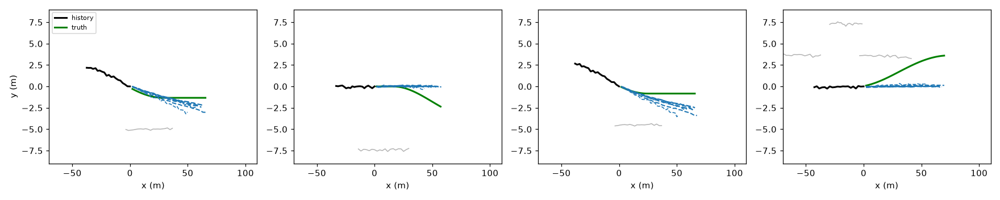

# Trajectory prediction with a transformer — multimodal, social, benchmarked

Predict where a car on a highway will be over the next **3 seconds** from
**2 seconds** of noisy observations of it and its neighbours — the
behaviour-prediction problem at the heart of autonomous driving. Built with
a **PyTorch transformer** (temporal + social attention, learned mode
queries), trained with the **winner-takes-all multimodal objective**, and
benchmarked honestly against classical baselines and ablations with the
standard metrics (**minADE / minFDE / miss rate**).

## Why multimodal

Simulated drivers decide *stochastically* when to change lanes or slow
down. The same 2-second history can be followed by keeping the lane,
moving left, or moving right — a single "average" prediction lands between
lanes and is wrong for all of them. The model therefore outputs **K = 6
candidate futures plus a confidence for each**, and is scored on the best
candidate (minADE@6) as well as its single most confident one (@1).

## Data

`src/traj_sim.py` — a 3-lane highway simulator with known ground truth:

| piece | what it does |
|---|---|
| car-following | Intelligent Driver Model (IDM), per-driver desired speed and headway |
| lane changes | simplified MOBIL rule: change when the target lane is meaningfully faster and the new follower is not forced to brake hard; plus rare unmotivated changes; 3–5 s smooth lateral profile |
| slowdowns | random events that drop a driver's desired speed, then recover |
| sensing | 10 Hz, 0.1 m position noise on observed history; the target is the *true* future |

`src/traj_dataset.py` builds agent-centric samples: the target plus up to
8 nearest neighbours (within 60 m), in the target's frame at the last
observed step, with a padding mask. Train 24,000 / test 4,800 samples, plus
a **dense-traffic shift set** (more, slower cars) never seen in training.
About 18% of test samples contain a lane change in the future window.

## Model (`src/traj_model.py`)

```
history (B, agents, 20 steps, [x, y, vx, vy])
  -> linear embed + learned time encoding + agent-type embedding
  -> temporal transformer   (self-attention over each agent's 20 steps)
  -> social transformer     (self-attention across agents, key-padding mask)
  -> mode decoder           (6 learned queries: self-attention, then
                             cross-attention to the scene tokens)
  -> per mode: 30-step trajectory residual + confidence logit
  -> trajectory = constant-velocity rollout + residual
```

Design choices, each tested:

- **Attention written from primitives** and verified against an independent
  NumPy reference (`src/attention_ref.py`) and PyTorch's
  `scaled_dot_product_attention`.
- **No positional encoding across agents**, so predictions are invariant to
  neighbour ordering by construction (tested by permuting slots).
- **Key-padding mask** for empty neighbour slots: filling them with garbage
  leaves predictions unchanged (tested).
- **Physics anchor**: the network predicts residuals on a constant-velocity
  rollout; with the residual head zeroed the model reproduces the CV
  baseline exactly (tested).
- **Winner-takes-all loss**: smooth-L1 on the mode closest to the truth plus
  cross-entropy teaching the confidences which mode that was.

## Baselines and ablations

| model | purpose |
|---|---|
| constant velocity | the classic kinematic baseline |
| constant acceleration | quadratic fit — shows how noise hurts higher-order extrapolation |
| ridge regression | strong linear baseline on the target's own history |
| transformer, K = 6 | full model |
| transformer, K = 6, no social | ablation: neighbours masked out — does interaction matter? |
| transformer, K = 1 | ablation: single-mode — does multimodality matter? |

## Results

Produced by CI (`python src/train_eval.py`, CPU, fixed seeds); full tables
in `results/results.md`, raw numbers in `results/metrics.json`, example
predictions in `results/examples.png`.

<!-- RESULTS -->
CI run on CPU (24,000 training samples, 4,800 test, 6,240 dense-traffic;
~17 min per transformer, 286k parameters). Errors in metres; MR = miss
rate (final-position error > 2 m).

**Test set, all samples**

| model | minADE@6 | minFDE@6 | MR@6 | ADE@1 | FDE@1 | MR@1 |
|---|---|---|---|---|---|---|
| constant velocity | — | — | — | 1.181 | 2.674 | 0.486 |
| constant acceleration | — | — | — | 2.780 | 7.108 | 0.935 |
| ridge regression | — | — | — | 0.865 | 2.060 | 0.346 |
| transformer, K = 6 | **0.442** | **0.853** | **0.099** | 1.033 | 2.393 | 0.439 |
| transformer, K = 6, no social attention | 0.443 | 0.865 | 0.100 | 1.038 | 2.403 | 0.423 |
| transformer, K = 1 | 0.853 | 2.000 | 0.329 | 0.853 | 2.000 | 0.329 |

**Lane-change samples (18% of test):** transformer K = 6 minFDE@6 1.78 m,
MR@6 0.39, vs. ridge FDE 3.04 m, MR 0.61.

**Dense traffic (never seen in training):** transformer K = 6 minFDE@6
0.76 m, MR@6 0.06; no degradation (slower traffic is easier).

### What the results say — including what did not work

- **Multimodality is the big win.** Six candidate futures cut the miss rate
  from 34.6% (best single-path baseline, ridge) to **9.9%** and the
  final-position error from 2.06 m to **0.85 m**.
- **The confidence head is weak.** The single most-confident mode (ADE/FDE@1)
  is *worse* than ridge (FDE 2.39 vs 2.06 m). Winner-takes-all training
  spread the modes, but the scores do not reliably pick the right one; the
  single-mode transformer (K = 1) only matches ridge (2.00 vs 2.06 m).
- **Social attention adds almost nothing here** (minFDE 0.853 vs 0.865 m).
  In this simulator lane-change timing is mostly random rather than a
  reaction to neighbours, so there is little interaction to learn — a
  property of the data, not evidence that interaction never matters.
- **Partial mode collapse on lane changes** (see `results/examples.png`):
  the six modes mostly differ in speed, not in manoeuvre. Before a lane
  change starts, all modes go straight; during one, modes overshoot the
  target lane because the model has no lane/map input.

Next steps these point to: a lane-graph or map encoding, explicit manoeuvre
(intent) modes or anchors, and calibrating the confidence head (e.g. a
separate classification loss weight sweep or temperature scaling).


<!-- /RESULTS -->

## Run it

```bash
pip install -r requirements.txt
pip install -r requirements-torch.txt      # CPU PyTorch
python -m pytest -v tests
python src/train_eval.py                   # ~20-30 min on CPU
python src/train_eval.py --quick           # small smoke run
```

Or with Docker (runs the tests during the build):

```bash
docker build -t traj-transformer .
docker run --rm -v "$PWD/results:/app/results" traj-transformer
```

## Limits

The data is simulated: straight highway, three lanes, no on-ramps, no map
input, and drivers that follow known rules. That is deliberate — it gives
exact ground truth and controlled multimodality — but real driving logs
are messier, and a production model would add map/lane-graph encoding,
more agent types, and much larger scale.
